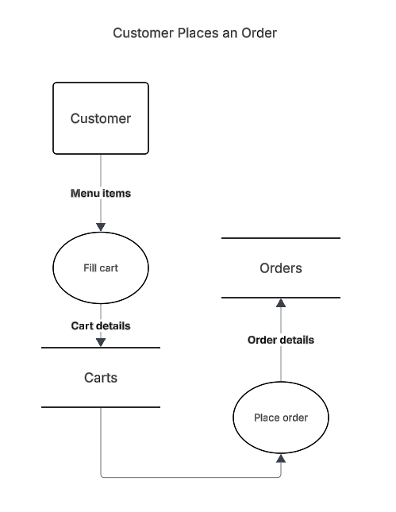
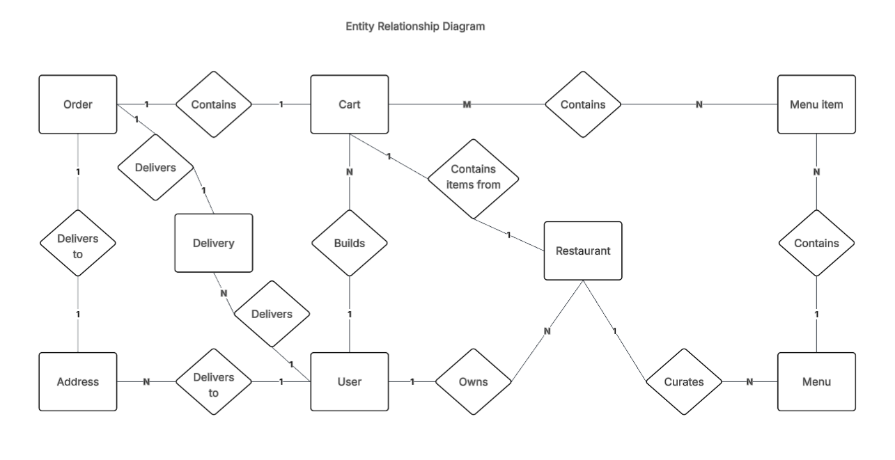

# Design Document

## Data Flow Diagrams

These diagrams are not exhaustive and 100% correct. They should be used to help us during implementation.




## Data Flow Diagrams

These diagrams are not exhaustive and 100% correct. They should be used to help us during implementation.


## URL Design

```
/api/restaurants
    POST
        Summary: create a restaurant.
        Headers: authorization.
        Body: PostRestaurantRequest.
        Responses:
            201: the restaurant is created and returned.
            401: the authorization token is missing or expired.
            403: the user is not a restaurateur.
            422: the PostRestaurantRequest is malformed.
    GET
        Summary: get a list of all current restaurants.
        Responses:
            200: a (potentially empty) list of all restaurants is returned.
    /search
        GET
            Summary: Get a list of restaurants that have the query within their name.
            Parameters: query (str).
            Responses:
                200: a (potentially empty) list of restaurants matching the query is returned.
    /{id}
        GET
            Summary: get a restaurant by ID.
            Responses:
                200: the restaurant is returned.
                404: a restaurant with that ID does not exist.
        PATCH
            Summary: update a restaurant by ID.
            Headers: authorization.
            Body: PatchRestaurantRequest.
            Responses:
                200: the restaurant is updated and returned.
                401: the authorization token is missing or expired.
                403: the user is not a restaurateur or they are one but they do not own the restaurant.
                404: a restaurant with that ID does not exist.
                422: the PatchRestaurantRequest is malformed.
        DELETE
            Summary: delete a restaurant by ID.
            Headers: authorization.
            Responses:
                204: the restaurant is deleted.
                401: the authorization token is missing or expired.
                403: the user is not a restaurateur or they are one but they do not own the restaurant.
                404: a restaurant with that ID does not exist.
/api/menus
    POST
        Summary: create a menu.
        Headers: authorization.
        Body: PostMenuRequest.
        Responses:
            201: the menu is created and returned.
            401: the authorization token is missing or expired.
            403: the user is not a restaurateur or they are one but they do not own the restaurant.
            404: the restaurant referenced in the request does not exist.
            422: the PostMenuRequest is malformed.
    GET
        Summary: get a list of all menus belonging to a restaurant.
        Parameters: restaurant_id (str).
        Responses:
            200: a (potentially empty) list of the restaurant's menus is returned.
            404: a restaurant with that ID does not exist.
            422: the restaurant parameter is missing or malformed.
    /{id}
        GET
            Summary: get a menu by ID.
            Responses:
                200: the menu is returned.
                404: a menu with that ID does not exist.
        PATCH
            Summary: update a menu by ID.
            Headers: authorization.
            Body: PatchMenuRequest.
            Responses:
                200: the menu is updated and returned.
                401: the authorization token is missing or expired.
                403: the user is not a restaurateur or they are one but they do not own the restaurant.
                404: a menu with that ID does not exist.
                422: the PatchMenuRequest is malformed.
        DELETE
            Summary: delete a menu by ID.
            Headers: authorization.
            Responses:
                204: the menu is deleted.
                401: the authorization token is missing or expired.
                403: the user is not a restaurateur or they are one but they do not own the restaurant.
                404: a menu with that ID does not exist.
/api/users
    POST
        Summary: create a user.
        Body: PostUserRequest.
        Responses:
            201: the user is created.
            409: a user with the same unique fields (e.g. email) already exists.
            422: the PostUserRequest is malformed.
    /{id}
        GET
            Summary: get a user by ID.
            Headers: authorization.
            Responses:
                200: the user is returned.
                401: the authorization token is missing or expired.
                403: the user is not an admin or they are not managing themself.
                404: a user with that ID does not exist.
        PATCH
            Summary: update a user by ID.
            Headers: authorization.
            Body: PatchUserRequest.
            Responses:
                200: the user is successfully updated and returned.
                401: the authorization token is missing or expired.
                403: the user is not an admin or they are not managing themself.
                404: a user with that ID does not exist.
                409: the update conflicts with an existing user (e.g. duplicate email).
                422: the PatchUserRequest is malformed.
        DELETE
            Summary: delete a user by ID.
            Headers: authorization.
            Responses:
                204: the user is successfully deleted.
                401: the authorization token is missing or expired.
                403: the user is not an admin or they are not managing themself.
                404: a user with that ID does not exist.
/api/menu-items
    GET
        Summary: get a list of menu items, optionally filtered by menu.
        Parameters: menu (id, optional), query (str, optional).
        Responses:
            200: a (potentially empty) list of matching menu items is returned.
            404: a menu with the given ID does not exist.
            422: a query parameter is malformed.
    POST
        Summary: create a menu item.
        Headers: authorization.
        Body: PostMenuItemRequest.
        Responses:
            201: the menu item is successfully created.
            401: the authorization token is missing or expired.
            403: that user is not authorized to add items to this menu.
            404: the menu referenced in the request does not exist.
            422: the PostMenuItemRequest is malformed.
    /{id}
        GET
            Summary: get a single menu item by ID.
            Responses:
                200: the menu item is returned.
                404: a menu item with that ID does not exist.
        PATCH
            Summary: update a single menu item by ID.
            Headers: authorization.
            Body: PatchMenuItemRequest.
            Responses:
                200: the menu item is successfully updated and returned.
                401: the authorization token is missing or expired.
                403: that user is not authorized to update this menu item.
                404: a menu item with that ID does not exist.
                422: the PatchMenuItemRequest is malformed.
        DELETE
            Summary: delete a single menu item by ID.
            Headers: authorization.
            Responses:
                204: the menu item is successfully deleted.
                401: the authorization token is missing or expired.
                403: that user is not authorized to delete this menu item.
                404: a menu item with that ID does not exist.

/api/orders
    GET
        Summary: get a list of the current user's orders.
        Headers: authorization.
        Responses:
            200: a (potentially empty) list of the current user's orders is returned.
            401: the authorization token is missing or expired.
    POST
        Summary: create an order.
        Headers: authorization.
        Body: PostOrderRequest.
        Responses:
            201: the order is successfully created.
            401: the authorization token is missing or expired.
            404: the restaurant or an item referenced in the request does not exist.
            422: the PostOrderRequest is malformed.
    /{id}
        GET
            Summary: get a single order by ID.
            Headers: authorization.
            Responses:
                200: the order is returned.
                401: the authorization token is missing or expired.
                403: that user is not authorized to view this order.
                404: an order with that ID does not exist.
        PATCH
            Summary: update a single order by ID.
            Headers: authorization.
            Body: PatchOrderRequest.
            Responses:
                200: the order is successfully updated and returned.
                401: the authorization token is missing or expired.
                403: that user is not authorized to update this order.
                404: an order with that ID does not exist.
                409: the order can no longer be updated (e.g. already being prepared).
                422: the PatchOrderRequest is malformed.
        /cancel
            POST
                Summary: cancel a single order by ID.
                Headers: authorization.
                Responses:
                    200: the order is successfully cancelled.
                    401: the authorization token is missing or expired.
                    403: that user is not authorized to cancel this order.
                    404: an order with that ID does not exist.
                    409: the order can no longer be cancelled.

/api/carts
    GET
        Summary: get the current user's active cart.
        Headers: authorization.
        Responses:
            200: the active cart is returned.
            401: the authorization token is missing or expired.
            404: the user has no active cart.
    PATCH
        Summary: update the current user's active cart.
        Headers: authorization.
        Body: PatchCartRequest.
        Responses:
            200: the cart is successfully updated and returned.
            401: the authorization token is missing or expired.
            404: the user has no active cart.
            422: the PatchCartRequest is malformed.
    DELETE
        Summary: clear the current user's active cart.
        Headers: authorization.
        Responses:
            204: the active cart is successfully cleared.
            401: the authorization token is missing or expired.
            404: the user has no active cart.
    /{restaurant id}
        GET
            Summary: get the items in the current user's cart for a restaurant.
            Headers: authorization.
            Responses:
                200: the cart for that restaurant is returned.
                401: the authorization token is missing or expired.
                404: the restaurant does not exist.
        PATCH
            Summary: update the current user's cart for a restaurant.
            Headers: authorization.
            Body: PatchCartRequest.
            Responses:
                200: the cart is successfully updated and returned.
                401: the authorization token is missing or expired.
                404: the restaurant does not exist.
                422: the PatchCartRequest is malformed.
        DELETE
            Summary: clear the current user's cart for a restaurant.
            Headers: authorization.
            Responses:
                204: the cart is successfully cleared.
                401: the authorization token is missing or expired.
                404: the restaurant does not exist.
        /activate
            POST
                Summary: make the cart for a restaurant the user's active cart.
                Headers: authorization.
                Responses:
                    200: the cart is now active and is returned.
                    401: the authorization token is missing or expired.
                    404: the restaurant does not exist.

/api/auth
    /login
        POST
            Summary: check credentials and create a session.
            Body: LoginRequest.
            Responses:
                200: the credentials are valid and a session is created.
                401: the credentials are incorrect.
                422: the LoginRequest is malformed.
    /logout
        POST
            Summary: delete the current session.
            Headers: authorization.
            Responses:
                204: the session is successfully deleted.
                401: the authorization token is missing or expired.

/web/restaurants/{restaurant-slug}/{menu-slug}/{id-slug}
    GET
        Summary: show the web page for a single menu item.
        Responses:
            200: the HTML page is returned.
            404: no restaurant, menu, or item matches the given slugs. 
```

## Data Design

### Entity Relationship Diagram



### Documents

While attempting to design the data structure in a relational fashion, it became apparent that designing a bespoke RDBMS would be difficult for the project. Therefore, this design is document-based. Each document listed below will exist as a json file and each value in the file will have the listed keys.

#### Users
- email: user contact email address, also acts as login username
- password_hash: encrypted user password string
- is_admin: boolean flag indicating administrative rights
- is_active: boolean flag showing account activity status
- addresses: nested map of saved delivery locations containing recipient names and address lines
- cart: nested map of unsubmitted items currently stored in the user's shopping cart

#### Restaurants
- owner_id: user ID reference indicating the restaurant's owner
- name: display name of the restaurant
- description: short overview text describing the establishment
- address: nested address object containing street, city, region, postcode and country
- phone_number: contact telephone number for the business
- is_active: boolean flag representing restaurant operational status
- cuisine_ids: array of linked cuisine tag IDs
- menus: nested map of menus containing active state and menu items

#### Orders

- orderer_id: user ID reference to the customer who submitted the order
- address: embedded delivery destination details, including recipient name
- placed_at: timestamp string recording when the order was submitted
- state: current lifecycle status of the order. States: (placed, preparing, waiting_for_driver, collected, delivered, cancelled)
- items: nested map of purchased items preserving historical name and price snapshots

Note that an order acts like a snapshot of an order when it was placed. Therefore, it may appear that there is some data redundency, but be assured that this is by design.  

For example, address is recorded again rather than relying on the orderer's address attribute. If the orderer later deleted their address or changed some of it, the record of the order will show erroneous data. It should represent the order at the time of ordering.

#### Deliveries
- order_id: order ID reference linking the delivery to a specific order
- deliverer_id: user ID of the assigned delivery driver
- state: current status tracking the delivery progress. States: (accepted, collected, delivered). Notice no cancelled state because the brief did not mention that deliveries could be cancelled once collected.
- delivered_at: timestamp string marking the completion time of delivery

#### Cuisines
- name: text label of the cuisine category used for restaurant filtering
