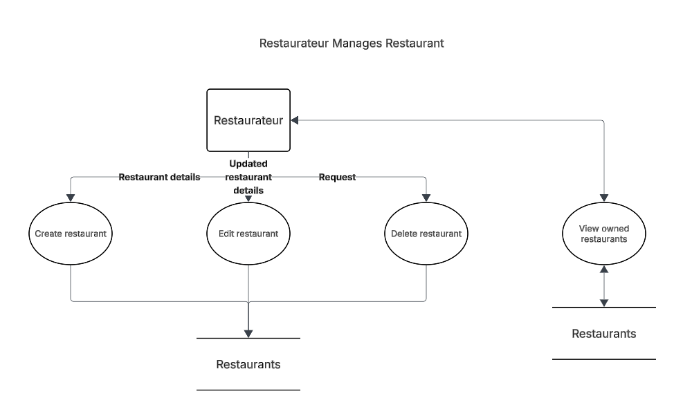
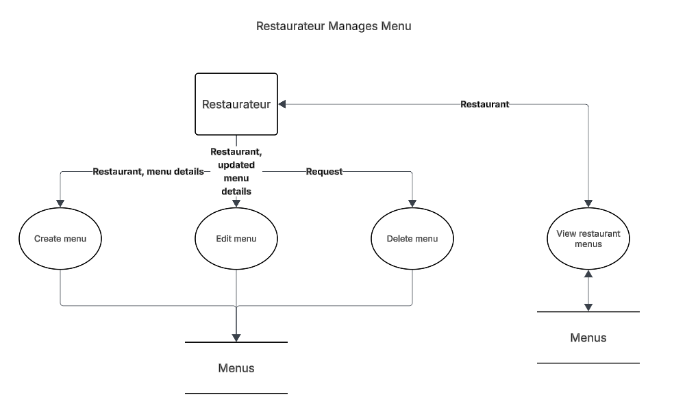

# Design Document

## Data Flow Diagrams

These diagrams are not exhaustive and 100% correct. They should be used to help us during implementation.






## Data Flow Diagrams

These diagrams are not exhaustive and 100% correct. They should be used to help us during implementation.


## URL Design

All endpoints will return 500 if an unhandled exception is raised in the backend. For simplicity, they are not documented on each endpoint.

```
/api
    /restaurants
        POST
            Summary: create a restaurant.
            Headers: authorization.
            Body: PostRestaurantRequest.
            Responses:
                201: the restaurant is created and returned.
                401: the authorization token is missing or expired.
                403: the user is not a restaurateur.
                422: the PostRestaurantRequest is malformed.
        GET
            Summary: get a list of restaurants that have the query within their name. If no query is passed, return all restaurants.
            Parameters: query (optional str).
            Responses:
                200: a (potentially empty) list of restaurants matching the query is returned.
        /{id}
            GET
                Summary: get a restaurant by ID.
                Responses:
                    200: the restaurant is returned.
                    404: a restaurant with that ID does not exist.
            PATCH
                Summary: update a restaurant by ID.
                Headers: authorization.
                Body: PatchRestaurantRequest.
                Responses:
                    200: the restaurant is updated and returned.
                    401: the authorization token is missing or expired.
                    403: the user is not a restaurateur or they are one but they do not own the restaurant.
                    404: a restaurant with that ID does not exist.
                    422: the PatchRestaurantRequest is malformed.
            DELETE
                Summary: delete a restaurant by ID.
                Headers: authorization.
                Responses:
                    204: the restaurant is deleted.
                    401: the authorization token is missing or expired.
                    403: the user is not a restaurateur or they are one but they do not own the restaurant.
                    404: a restaurant with that ID does not exist.
    /menus
        POST
            Summary: create a menu.
            Headers: authorization.
            Body: PostMenuRequest.
            Responses:
                201: the menu is created and returned.
                401: the authorization token is missing or expired.
                403: the user is not a restaurateur or they are one but they do not own the restaurant.
                404: the restaurant referenced in the request does not exist.
                422: the PostMenuRequest is malformed.
        GET
            Summary: get a list of all menus belonging to a restaurant.
            Parameters: restaurant_id (str).
            Responses:
                200: a (potentially empty) list of the restaurant's menus is returned.
                404: a restaurant with that ID does not exist.
                422: the restaurant parameter is missing or malformed.
        /{id}
            GET
                Summary: get a menu by ID.
                Responses:
                    200: the menu is returned.
                    404: a menu with that ID does not exist.
            PATCH
                Summary: update a menu by ID.
                Headers: authorization.
                Body: PatchMenuRequest.
                Responses:
                    200: the menu is updated and returned.
                    401: the authorization token is missing or expired.
                    403: the user is not a restaurateur or they are one but they do not own the restaurant.
                    404: a menu with that ID does not exist.
                    422: the PatchMenuRequest is malformed.
            DELETE
                Summary: delete a menu by ID.
                Headers: authorization.
                Responses:
                    204: the menu is deleted.
                    401: the authorization token is missing or expired.
                    403: the user is not a restaurateur or they are one but they do not own the restaurant.
                    404: a menu with that ID does not exist.
    /menu-items
        POST
            Summary: create a menu item.
            Headers: authorization.
            Body: PostMenuItemRequest.
            Responses:
                201: the menu item is created and returned.
                401: the authorization token is missing or expired.
                403: the user is not a restaurateur or they are one but they do not own the restaurant.
                404: the menu referenced in the request does not exist.
                422: the PostMenuItemRequest is malformed.
        GET
            Summary: get a list of menu items for a given menu that have the query within their name. If no query is passed, return all menu items for that menu.
            Parameters: menu_id (str), query (optional str).
            Responses:
                200: a (potentially empty) list of matching menu items is returned.
                404: a menu with the given ID does not exist.
                422: a query parameter is malformed.
        /{id}
            GET
                Summary: get a menu item by ID.
                Responses:
                    200: the menu item is returned.
                    404: a menu item with that ID does not exist.
            PATCH
                Summary: update a menu item by ID.
                Headers: authorization.
                Body: PatchMenuItemRequest.
                Responses:
                    200: the menu item is updated and returned.
                    401: the authorization token is missing or expired.
                    403: the user is not a restaurateur or they are one but they do not own the restaurant.
                    404: a menu item with that ID does not exist.
                    422: the PatchMenuItemRequest is malformed.
            DELETE
                Summary: delete a menu item by ID.
                Headers: authorization.
                Responses:
                    204: the menu item is deleted.
                    401: the authorization token is missing or expired.
                    403: the user is not a restaurateur or they are one but they do not own the restaurant.
                    404: a menu item with that ID does not exist.
    /users
        POST
            Summary: create a user.
            Body: PostUserRequest.
            Responses:
                201: the user is created and returned.
                409: a user with the same unique fields (e.g. email) already exists.
                422: the PostUserRequest is malformed.
        /{id}
            GET
                Summary: get a user by ID.
                Headers: authorization.
                Responses:
                    200: the user is returned.
                    401: the authorization token is missing or expired.
                    403: the user is not an admin or they are not managing themself.
                    404: a user with that ID does not exist.
            PATCH
                Summary: update a user by ID.
                Headers: authorization.
                Body: PatchUserRequest.
                Responses:
                    200: the user is updated and returned.
                    401: the authorization token is missing or expired.
                    403: the user is not an admin or they are not managing themself.
                    404: a user with that ID does not exist.
                    409: the update conflicts with an existing user (e.g. duplicate email).
                    422: the PatchUserRequest is malformed.
            DELETE
                Summary: delete a user by ID.
                Headers: authorization.
                Responses:
                    204: the user is deleted.
                    401: the authorization token is missing or expired.
                    403: the user is not an admin or they are not managing themself.
                    404: a user with that ID does not exist.
    /orders
        POST
            Summary: create an order.
            Headers: authorization.
            Body: PostOrderRequest.
            Responses:
                201: the order is created.
                401: the authorization token is missing or expired.
                404: a menu-item in the order does not exist.
                422: the PostOrderRequest is malformed.
        GET
            Summary: get a list of all orders with an optional user ID parameter.
            Headers: authorization.
            Parameters: user_id (optional str)
            Responses:
                200: a (potentially empty) list of all matching orders is returned.
                401: the authorization token is missing or expired.
                403: the user is not an admin and is not getting their own orders.
                404: a user with that ID does not exist.
                422: a query parameter is malformed.
        /{id}
            GET
                Summary: get an order by ID.
                Headers: authorization.
                Responses:
                    200: the order is returned.
                    401: the authorization token is missing or expired.
                    403: the user is not an admin and they do not own the order.
                    404: an order with that ID does not exist.
            PATCH
                Summary: update an order by ID.
                Headers: authorization.
                Body: PatchOrderRequest.
                Responses:
                    200: the order is updated and returned.
                    401: the authorization token is missing or expired.
                    403: the user is not an admin and they do not own the order.
                    404: an order with that ID does not exist.
                    409: the order can no longer be updated (e.g. already being prepared).
                    422: the PatchOrderRequest is malformed.
            /cancel
                POST
                    Summary: cancel a order by ID.
                    Headers: authorization.
                    Responses:
                        200: the order is cancelled.
                        401: the authorization token is missing or expired.
                        403: the user is not an admin and they do not own the order.
                        404: an order with that ID does not exist.
                        409: the order can no longer be cancelled.
    /auth
        /login
            POST
                Summary: check credentials and create a session.
                Body: LoginRequest.
                Responses:
                    200: the credentials are valid and a session is created. A token is returned too.
                    401: the credentials are incorrect.
                    422: the LoginRequest is malformed.
        /logout
            POST
                Summary: delete the current session.
                Headers: authorization.
                Responses:
                    200 (not 204 because the method is POST): the session is deleted.
                    401: the authorization token is missing or expired.


FROM HERE BELOW IS NOT FINISHED. WE NEED TO ACCOUNT FOR 1 CART PER USER PER RESTAURANT.

/carts
    GET
        Summary: get the current user's active cart.
        Headers: authorization.
        Responses:
            200: the active cart is returned.
            401: the authorization token is missing or expired.
            404: the user has no active cart.
    PATCH
        Summary: update the current user's active cart.
        Headers: authorization.
        Body: PatchCartRequest.
        Responses:
            200: the cart is updated and returned.
            401: the authorization token is missing or expired.
            404: the user has no active cart.
            422: the PatchCartRequest is malformed.
    DELETE
        Summary: clear the current user's active cart.
        Headers: authorization.
        Responses:
            204: the active cart is cleared.
            401: the authorization token is missing or expired.
            404: the user has no active cart.
    /{restaurant id}
        GET
            Summary: get the items in the current user's cart for a restaurant.
            Headers: authorization.
            Responses:
                200: the cart for that restaurant is returned.
                401: the authorization token is missing or expired.
                404: the restaurant does not exist.
        PATCH
            Summary: update the current user's cart for a restaurant.
            Headers: authorization.
            Body: PatchCartRequest.
            Responses:
                200: the cart is updated and returned.
                401: the authorization token is missing or expired.
                404: the restaurant does not exist.
                422: the PatchCartRequest is malformed.
        DELETE
            Summary: clear the current user's cart for a restaurant.
            Headers: authorization.
            Responses:
                204: the cart is cleared.
                401: the authorization token is missing or expired.
                404: the restaurant does not exist.
        /activate
            POST
                Summary: make the cart for a restaurant the user's active cart.
                Headers: authorization.
                Responses:
                    200: the cart is now active and is returned.
                    401: the authorization token is missing or expired.
                    404: the restaurant does not exist.

NOT /api!

/web/restaurants/{restaurant-slug}/{menu-slug}/{id-slug}
    GET
        Summary: show the web page for a menu item.
        Responses:
            200: the HTML page is returned.
            404: no restaurant, menu, or item matches the given slugs. 
```

## Data Design

### Entity Relationship Diagram

The ERD on file is not up to date. It needs to be updated to support 1 cart per user per restaurant.
